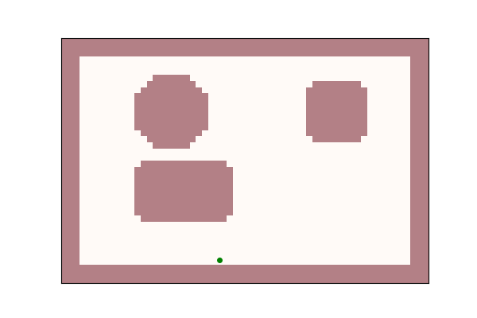
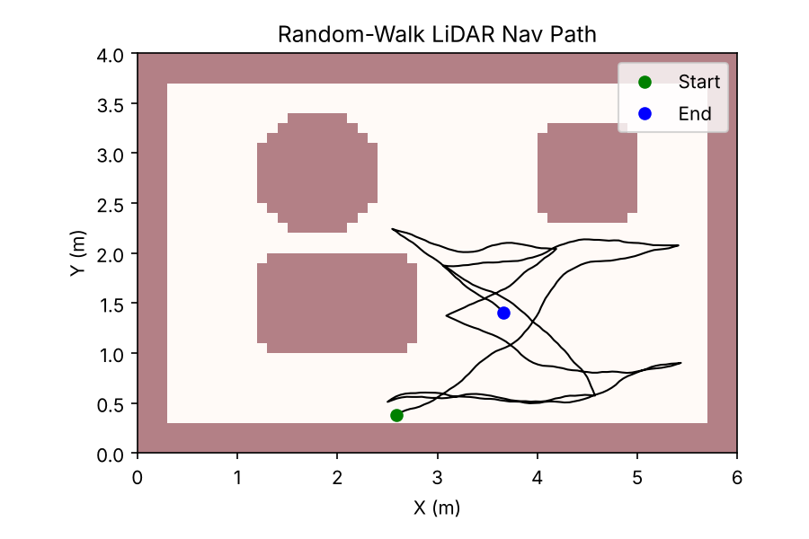

# LiDAR Navigation Simulation

A Python simulation of a LiDAR-equipped robot moving through a room and avoiding obstacles. The robot "sees" with a simulated 360° LiDAR scan and steers away from anything in its path.

Built as the foundation for a mobility-enabled assistive medical device (a pill dispenser that can navigate a room), during the DREAM STEM Research Institute at NCCU, Summer 2025.



## How it works

**The map.** The room is a 6 m × 4 m occupancy grid at 10 cm resolution (`lidar_room_grid.npz`), with walls and three obstacles. Obstacles are *inflated* by the robot's radius (0.2 m) plus a 5 cm safety buffer, so the robot treats anything too close as blocked.

**The LiDAR.** Every step, the robot casts 180 beams in a full circle. Each beam travels outward until it hits a wall or obstacle, giving a distance reading in that direction, like a real LiDAR sensor.

**The navigation.**
- If anything is closer than 0.35 m in the front ±30° arc, the robot turns toward the most open direction.
- Otherwise, it keeps moving with a small random wobble (a random walk).
- Any move that would enter an obstacle is blocked, and the robot picks a new heading.



## Files

```
lidar_nav_sim.py       # Simulation: map loading, LiDAR raycasting, navigation, plotting
lidar_room_grid.npz    # Room occupancy grid and metadata
lidar_nav_anim.gif     # Animation of the robot moving
lidar_nav_path.png     # Full path plot
```

## Run it

```
pip install numpy matplotlib imageio
python lidar_nav_sim.py --data lidar_room_grid.npz --steps 400 --seed 123
```

Change `--seed` for a different random path, or `--steps` to run longer.

## Next steps

- Replace the synthetic map with real LiDAR scans
- Add goal-directed path planning (for example, A*) instead of a random walk
- Run it on hardware with a physical LiDAR sensor

## Notes

Built with help from AI coding tools and public LiDAR examples, as part of the DREAM STEM Research Institute (NCCU).
